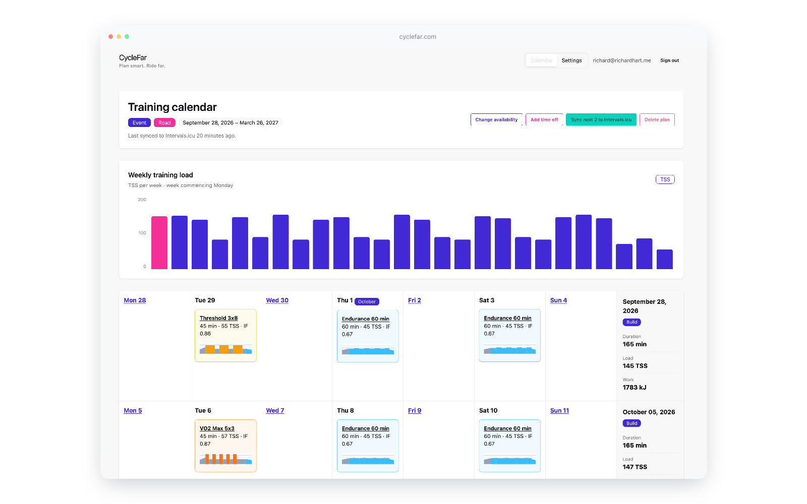

# CycleFar

CycleFar is a cycling training planner, live at <https://cyclefar.com>. It turns a rider's
goal, availability, FTP and target event into a deterministic training plan, then keeps
the calendar practical as workouts are completed, missed or changed.



## Features

- Plan creation with a preview, for general fitness, FTP, endurance, climbing and event goals.
- A deterministic workout engine covering endurance, tempo, Sweet Spot, threshold, VO2 max,
  over-under and recovery sessions, with weekly load limits, recovery weeks and event tapers.
- A continuous weekly calendar with workout graphs, TSS/IF/work and editable future workouts.
- Completion feedback, missed-workout handling and adaptation proposals you accept or reject.
- Availability changes, time off and a gradual return after illness.
- FTP history: future targets follow FTP changes, while completed workouts keep their
  original watts.
- Optional FIT file upload to compare a completed ride with the plan.
- Manual sync to Intervals.icu, touching only events CycleFar created.
- Self-registered rider accounts; all data is scoped to the signed-in rider.

V1 has no automatic ride imports, trainer control, notifications or automatic calendar sync.
See the [product overview](docs/PRODUCT.md) and [training-engine rules](docs/TRAINING_ENGINE.md)
for how plans are built and adapted.

## Local setup

Requires Ruby **4.0.6**, Bundler, libvips and PostgreSQL **17+** (with `psql` and `pg_dump`
on `PATH`, and a role that can create databases). Set `PGHOST`, `PGPORT`, `PGUSER` and
`PGPASSWORD` if needed.

```sh
rbenv install -s 4.0.6
bundle install
bin/rails db:create db:schema:load   # first time only
bin/setup --skip-server
bin/dev
```

Open <http://localhost:3000> and choose **Register**. Afterwards, `bin/setup --skip-server`
and `bin/dev` are enough. Avoid `bin/setup --reset` on a fresh database: its seed needs an
existing rider.

`bin/setup` creates local Active Record Encryption keys in `config/` (ignored by Git). Keep
them with any database backup; without them a saved Intervals.icu API key can't be decrypted.

### Sample plan

To load a 12-week Increase FTP plan (260 W FTP; Tue/Sat 60 min intervals, Thu 90 min and
Sun 120 min endurance; 3 hard weeks then 1 recovery) for an existing local rider:

```sh
CYCLEFAR_SEED_USER_EMAIL=rider@example.com bin/rails db:seed
```

The seed does nothing if the rider already has an active plan, and never runs in production.

## Intervals.icu

Save an API key in **Settings**, then use the calendar's sync action. Sync uploads upcoming
structured workouts with stable `cyclefar-workout-<id>` IDs and removes only CycleFar-owned
events that no longer belong. It never imports rides or touches other events. See the
[integration guide](docs/INTERVALS_ICU.md).

## Validation

```sh
bin/ci
```

This runs setup, then `rspec`, `zeitwerk:check`, the plan-form Node test, RuboCop,
bundler-audit, importmap audit and Brakeman. System specs need Chrome and the Node test
needs Node.js; the app itself needs neither. Specs never call the live Intervals.icu API.

## Deployment

The app is deployed with Kamal **2.12.0** to a server with an external PostgreSQL
database. Images are built and pushed from the deploying machine; GitHub Actions only
validates. AWS infrastructure is provisioned separately with
[Terraform](infra/README.md) or [CloudFormation](infra/cloudformation/README.md).

1. Set up Rails credentials (`bin/rails credentials:edit`) using
   [the example](config/credentials.yml.enc.example). `.kamal/secrets` prefers exported
   environment variables and falls back to those credentials.
2. Create a private, Git-ignored `.env.deploy` with:

   | Variable | Value |
   | --- | --- |
   | `CYCLEFAR_WEB_HOST` | Application server IP or hostname |
   | `CYCLEFAR_DB_HOST` | PostgreSQL endpoint |
   | `KAMAL_REGISTRY_USER` | Registry username (also used in the image name) |
   | `KAMAL_SSH_KEY` | Optional; defaults to `~/.ssh/id_ed25519` |
   | `CYCLEFAR_MAIL_FROM` | Authorized sender address |
   | `CYCLEFAR_SMTP_HOST` / `_USERNAME` / `_PASSWORD` | SMTP settings |
   | `ACTIVE_RECORD_ENCRYPTION_PRIMARY_KEY` | Production encryption keys |
   | `ACTIVE_RECORD_ENCRYPTION_DETERMINISTIC_KEY` | |
   | `ACTIVE_RECORD_ENCRYPTION_KEY_DERIVATION_SALT` | |

3. From a commit whose CI has passed, with Docker running:

   ```sh
   chmod 600 .env.deploy
   ( set -a; source .env.deploy; set +a; bin/kamal deploy )   # bin/kamal setup the first time
   ```

Kamal expects the database on port `5432` with user `cyclefar`, and SMTP on port `587`.
For your own domain, change `proxy.host` and `CYCLEFAR_APP_HOST` in `config/deploy.yml`.

Never replace the production encryption keys while Intervals.icu API keys are stored.
For a new install, generate them once with `bin/rails db:encryption:init`. Mail and
account provisioning are covered in the [account access guide](docs/ACCOUNT_ACCESS.md).

**Health check:** `GET /up` returns `200` once Rails boots. It needs no sign-in and checks
liveness only, not the database. With this repository's Dockerfile, the app listens on
port `80` (Thruster); for example, Coolify can use an HTTP check on `localhost:80/up`.

## Documentation

- [Product overview](docs/PRODUCT.md) and [requirements](docs/REQUIREMENTS.md)
- [Training-engine rules](docs/TRAINING_ENGINE.md)
- [Architecture](docs/ARCHITECTURE.md), [data model](docs/DATA_MODEL.md) and [diagrams](docs/diagrams/README.md)
- [UX guide](docs/UX.md)
- [Intervals.icu integration](docs/INTERVALS_ICU.md)
- [Account access and production mail](docs/ACCOUNT_ACCESS.md)
- [External references](docs/SOURCES.md)

## License

CycleFar is released under the [MIT License](LICENSE).
